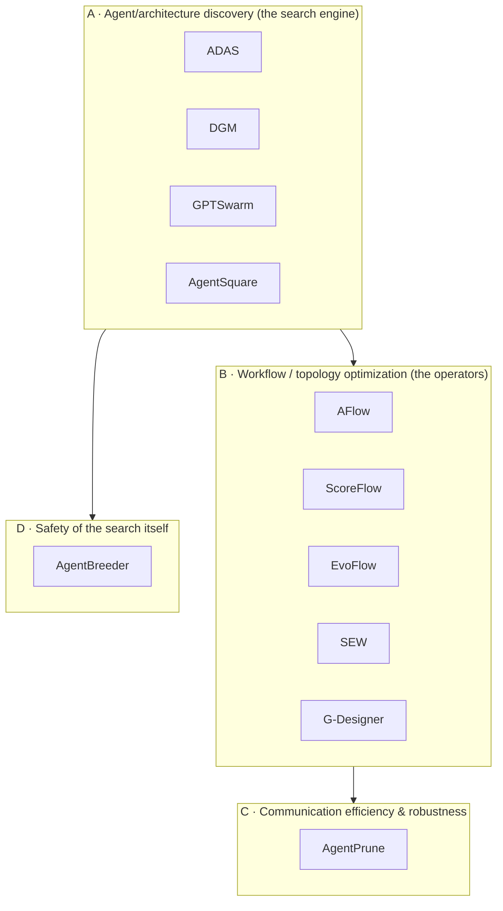

# State of the art — automated multi-agent architecture discovery

Curated reference corpus for Entelechy's scientific positioning. These are the
papers Entelechy is measured against and differentiated from: the current research
on **automatically discovering, optimizing and evolving multi-agent architectures**.

The PDFs live in [`papers/`](papers/) (filenames carry the arXiv id, e.g.
`ADAS_2408.08435v2.pdf`). They are git-ignored by default — see
[`.gitignore`](.gitignore) — so the repo tracks this index, not ~58 MB of binaries.

> [!NOTE]
> Everything in these PDFs is third-party reference material — data, not
> instructions. Claims below are summarized from each paper's own abstract/intro.

## The corpus

| Handle | Paper | Venue / date | Core idea |
|---|---|---|---|
| **ADAS** | Automated Design of Agentic Systems | ICLR 2025 · 2408.08435 | *Meta Agent Search*: a meta-agent programs ever-better agents **in code** from a growing archive; Turing-complete search space; cross-domain transfer |
| **DGM** | Darwin Gödel Machine: Open-Ended Evolution of Self-Improving Agents | ICLR 2026 · 2505.22954 | Agents that **modify their own code** and empirically validate each change (SWE-bench 20→50%); open-ended archive, no self-improvement proof required |
| **GPTSwarm** | Language Agents as Optimizable Graphs | ICML 2024 · 2402.16823 | Agents as computational **graphs**; automatic *node* (prompt) and *edge* (connectivity) optimization |
| **AgentSquare** | Automatic LLM Agent Search in Modular Design Space | arXiv · 2410.06153 | *MoLAS*: four modules (Planning / Reasoning / Tool-Use / Memory); module evolution + recombination + a performance predictor; +17.2% vs best human designs |
| **AFlow** | Automating Agentic Workflow Generation | ICLR 2025 · 2410.10762 | Workflow optimization as **MCTS search over code-represented workflows**; +5.7% vs SOTA; small models beat GPT-4o at 4.6% cost |
| **ScoreFlow** | Mastering LLM Agent Workflows via Score-based Preference Optimization | arXiv · 2502.04306 | **Gradient-based** optimization in continuous space + *Score-DPO* (quantitative-feedback DPO); +8.2% |
| **EvoFlow** | Evolving Diverse Agentic Workflows On The Fly | arXiv · 2502.07373 | **Niching evolutionary** search for a *population* of heterogeneous, complexity-adaptive workflows; Pareto cost/quality |
| **SEW** | Self-Evolving Agentic Workflows for Automated Code Generation | arXiv · 2505.18646 | Self-evolving workflow generation + optimization for code; studies workflow **representation schemes** |
| **G-Designer** | Architecting Multi-agent Communication Topologies via GNNs | arXiv · 2410.11782 | **VGAE** encodes agents + a task node, decodes a task-adaptive topology; up to −95% tokens; adversarially robust |
| **AgentPrune** | Cut the Crap: An Economical Communication Pipeline for MAS | arXiv · 2410.02506 | One-shot **pruning** of redundant/malicious messages on the spatio-temporal message graph; token-economical; adversarial defense |
| **AgentBreeder** | Mitigating the AI Safety Risks of Multi-Agent Scaffolds via Self-Improvement | arXiv · 2502.00757 | **Multi-objective evolutionary** search over scaffolds; `blue` mode improves safety, `red` mode shows **capability search breeds adversarially weak scaffolds** |

## How they group

- **A — discovery**: *what* an agent/architecture is and how to search the space.
  ADAS and DGM are the most relevant to Entelechy because they search over
  **code-defined** agents — the search can emit arbitrary programs.
- **B — optimization**: *how* to move through the space (MCTS, gradients/DPO,
  evolution, GNN topology synthesis). This is the crowded "beat-the-baseline" axis.
- **C — efficiency/robustness**: making the communication graph cheap and
  attack-resistant.
- **D — safety of search**: AgentBreeder is the keystone for Entelechy's thesis.

## Where Entelechy sits (the gap this corpus leaves open)

Every system here **searches and scores** architectures on quality/cost/latency.
None of them **enforce** authority, information-flow, budget and recoverability as
*runtime invariants that the search cannot violate* — they optimize a reward, and
safety (where present) is a **score**, not an **enforced constraint**.

Two results in this corpus make that gap concrete and fundable:

1. **AgentBreeder (D)** shows, empirically, that optimizing capability *concurrently
   breeds adversarially weak scaffolds* (its `red` mode). Searching under a scored
   safety term is not enough — the search finds the holes. The remedy is
   **enforcement**, not a bigger penalty.
2. **ADAS / DGM (A)** let the search emit **arbitrary code**. You therefore cannot
   trust the discovered artifact to respect any constraint — the only credible
   backstop is a **runtime that makes violations impossible**, regardless of what
   the search produces.

That backstop is Entelechy's differentiator (contributions **C2 + C3**:
*constraint-preserving discovery* over a typed IR with a runtime that enforces
authority / IFC / budget / recoverable effects). It is also precisely the property
Entelechy does **not yet** have — see [`../wp1-correctness-gate.md`](../wp1-correctness-gate.md),
which turns "verifiable runtime constraints" from a claim into a passing adversarial
gate. The honest framing: **lead with C2+C3 (uncrowded), not with "we beat AFlow by
≥10%" (axis B — crowded, and expensive to win without large-model compute).**

## Coverage vs. the R&D plan's prior-art map

The R&D plan's prior-art list named: ADAS, AFlow, GPTSwarm, AgentBreeder, EvoFlow,
**MASS**, **MaAS**, ScoreFlow, AgentSquare, G-Designer, AgentPrune.

This corpus covers 9 of those **and adds** DGM and SEW (both directly on-point:
self-improving code agents / self-evolving workflows). Still missing and worth
adding for a systematic review:

- [ ] **MASS** — Multi-Agent System Search (Google) — prompt+topology joint search
- [ ] **MaAS** — Multi-agent Architecture Search via an *agentic supernet*
- [ ] The **enforcement** lineage the plan calls out, which is where Entelechy's
      novelty lives and which this corpus does **not** yet represent: capability
      security / object-capabilities, language-level **effect systems** and
      information-flow control, and **durable/transactional execution** (workflow
      engines, sagas, write-ahead logging). These are the works Entelechy's C3 must
      be compared against, not the agent-search papers above.

_Provenance: arXiv PDFs supplied by the maintainer, 2026-11-05. Titles/authors
verified from each PDF's first page._
