# WP1 — Runtime correctness gate

**Status:** ✅ WP1 landed, committed and green — all five workstreams + the acceptance
drill (commits `d0703df` + `3316c2f`, pushed). Downstream: WP2 shadow write-interception
(`6bfe132`) and the shadow→governance bridge (`021b8f8`) also landed. · **Owner:**
runtime core · **Blocks:** every downstream experimental claim (H2, H3) and the
"verifiable runtime constraints" differentiator — now unblocked.

## Thesis

Entelechy's scientific differentiator is *architecture discovery under **verifiable**
runtime constraints* — a runtime where a discovered architecture **cannot** violate
authority, information-flow, budget or recoverability, no matter what the search
emits (see [`state-of-the-art/README.md`](state-of-the-art/README.md): ADAS/DGM emit
arbitrary code; AgentBreeder shows capability search *breeds* unsafe scaffolds, so a
*scored* safety term is not enough — only **enforcement** is).

Today that claim is **false on four paths**. WP1 is the unit that makes it true and,
crucially, *demonstrable*: a red-team suite + a CLI drill that a generated
architecture cannot get past. WP1 is **depth, not breadth** — no new roadmap
features; it hardens the execution core the whole thesis rests on.

> [!WARNING]
> The adversarial acceptance suite below is expected to **fail today**. That is the
> point: WP1 is "red → green" on invariants the system currently violates. A passing
> suite is itself the first fundable/publishable artifact (the enforcement claim made
> concrete), independent of whether the search beats any baseline.
>
> **Resolved 2026-11-06:** the suite is now **green** — all five workstreams landed and
> the acceptance gate passes (see the status line and the per-workstream NOTE blocks).
> The red→green transition is complete; this block is kept for the original rationale.

> [!NOTE]
> **WS1 landed (2026-11-05, uncommitted).** `Par`/`Map` now fold `ValueMeta::join`
> over the input and every child, so neither launders confidentiality or taint. Four
> live-path adversarial probes are green in `entelechy-runtime` (28/28):
> `par_joins_input_and_child_labels_without_forcing_taint`,
> `map_item_inherits_collection_taint`, `map_result_preserves_collection_taint`,
> `map_cannot_launder_taint_past_a_policy_gate` — the last is the `Map`→egress
> laundering attack with a trusted positive control. `cargo fmt` and
> `clippy -D warnings` clean on the crate. These are this plan's SEC-01/SEC-02
> acceptance tests (per the D1 dossier). Tests landed inline in `lib.rs` beside the
> shared engine/policy helpers; the standalone `tests/wp1_enforcement.rs` is deferred
> to WS2+. Remaining order: WS2 → WS5.

> [!NOTE]
> **WS4 landed (2026-11-05, uncommitted).** The journal now records the initial run
> input (`Journal::input`, `#[serde(default)]`), and `outcome_output`/`replay`/
> `counterfactual` reconstruct from it instead of a hardcoded `{}`. `replay` verifies
> a supplied input against the recorded one (new `ReplayMismatch::InputMismatch`);
> `counterfactual` dropped its input parameter (and the `entelechy counterfactual
> --input` CLI flag) and seeds from the recorded input. The **journal format bumped
> `1 → 2`** with the full frozen-contract ripple (`JOURNAL_FORMAT_VERSION`, the
> `golden_journal.rs` byte fixture, `entelechy.journal` in `FROZEN_CONTRACTS` and
> `docs/contracts-1.0.md`, CHANGELOG); a v1 journal still deserializes (input → `{}`).
> Three probes are green in `entelechy-runtime` (**31/31** unit + **2/2** golden):
> `replay_uses_recorded_input_not_empty`, `journal_records_initial_input`,
> `replay_detects_input_tampering`. No new deps; phase gate unchanged.

> [!NOTE]
> **WS3 landed (2026-11-05, uncommitted).** Counterfactual live re-execution now
> passes the same gates as `Execute`: shared `guard_model`/`guard_tool` (authorize
> then budget) run in both the `Execute` arm and the diverged `Counterfactual` arm,
> and `Mode::Counterfactual` carries a fresh `Counters` so the live span is charged
> the model/tool budget (the replayed pre-divergence span is not). Three probes green
> (`counterfactual_live_tool_is_authorized`, `counterfactual_respects_tool_and_model_budgets`,
> `counterfactual_model_egress_is_routed`); runtime **34/34** + golden **2/2**; full
> gate clean (**377** workspace tests). No new deps; phase gate unchanged. Remaining
> order: WS2 → WS5.

> [!NOTE]
> **WS2 landed (2026-11-05, uncommitted).** `Engine` gained an `authority_stack`,
> seeded from `program.authority` in `execute`/`replay`/`counterfactual` and narrowed
> by every enclosing `Delegate`. The `Delegate` arm halts (new
> `FailureReason::AuthorityDenied`) on a widening envelope and pushes/pops the
> narrowed one; `authorize_tool` denies a capability outside the active envelope when
> inside a delegated scope (depth > 1), enforced independent of policy. No-`Delegate`
> programs are unchanged (depth 1, ambient = `program.authority`). Five SEC probes
> green in the new `tests/wp1_enforcement.rs`: `delegate_narrows_active_authority`,
> `delegate_rejects_runtime_widening`, `nested_delegates_narrow_monotonically`,
> adversarial `data_dependent_capability_cannot_escape_delegate`, regression
> `delegate_free_programs_behave_identically`. No new deps; phase gate unchanged.

> [!NOTE]
> **WS5 landed (2026-11-05, uncommitted).** The `Execute` tool arm journals a durable
> write-ahead intent (`ToolEffect { commit: Unknown }`) *before* dispatch and resolves
> it in place to `Committed` on acknowledgement; an unacknowledged dispatch leaves the
> dangling `Unknown` and the run ends in `ReconciliationRequired` (existing
> `has_unknown_commit` derivation). Completed runs still hold one effect per tool node
> — the golden journal is byte-stable, **no format bump**. Three REP probes green:
> `tool_intent_is_journaled_before_dispatch`,
> `crash_between_dispatch_and_commit_is_recoverable`,
> `tool_intent_resolves_to_committed_on_acknowledgement`.

> [!NOTE]
> **Acceptance drill landed (2026-11-05, uncommitted).** `entelechy drill --kind
> enforcement` (and under `--kind all`) runs `entelechy_runtime::enforcement_drill` —
> adversarial programs over WS1–WS5 — and reports every invariant SATISFIED, failing
> closed otherwise. Validated at the crate level: `entelechy-runtime` **35** unit +
> **2** golden + **8** `wp1_enforcement` tests green; `entelechy-cli` builds and the
> drill prints SATISFIED; `fmt` + `clippy --all-targets -D warnings` clean on both
> changed crates. **Full gate green (2026-11-06):** `fmt --all --check`, `clippy
> --workspace --all-targets -D warnings` (+ gateway `wasm,openai-tls`), `test
> --workspace` (~386 tests, 0 failures, incl. runtime **35** unit + **2** golden +
> **8** `wp1_enforcement`), `doc --workspace -D warnings`, and `requirements --check`
> (PASS at P5, unchanged) all clean; `drill --kind all` reports every drill SATISFIED.
> No new deps (no `Cargo.toml` change). The work is uncommitted, pending the user's go-ahead.

## The four confirmed gaps (verified 2026-11-05 against the working tree)

| # | Invariant that should hold | What the code does instead | Location |
|---|---|---|---|
| 1 | IFC: a combinator's output carries the **join** of its inputs' confidentiality labels; taint is never silently lowered (IR-I9 / PRD 7.5, 5.8) | `Par` discards each child's `meta` and wraps `Value::tainted(..)`; `Map` wraps each item `Value::trusted(item)` and returns `Value::trusted(Array)` — **laundering taint & confidentiality** | `entelechy-runtime/src/exec.rs:124` (Par), `:160` (Map) |
| 2 | Authority: inside a `Delegate`, every effect is authorized against the **narrowed** envelope, at runtime (A1/A2/IR-I6, PRD 5.4) | ✅ **fixed (WS2)** — `Engine.authority_stack` seeds from `program.authority` and narrows per `Delegate`; the arm halts on a widening envelope (`AuthorityDenied`) and `authorize_tool` consults the active envelope inside a delegated scope | `exec.rs` (Delegate arm), `lib.rs` (`authorize_tool`) |
| 3 | Parity: an effect that acts for real passes the **same** authorization + budget gates in every mode (PRD 8.3, 10.2 / RK-8) | ✅ **fixed (WS3)** — shared `guard_model`/`guard_tool` run in both `Execute` and the diverged `Counterfactual` arm; `Counterfactual` carries budget `Counters` | `exec.rs` (Llm/Tool arms) |
| 4 | Replay reconstructs from the **recorded original input** (RK-2) | ✅ **fixed (WS4)** — journal records `input`; `outcome_output`/`replay`/`counterfactual` seed from it | `exec.rs:58`,`:77` |

A fifth, adjacent gap (durability half of "recovery") is folded in as WS5:

| 5 | Write-ahead: a durable **intent** is recorded *before* an effect; a dangling intent forces reconciliation (PRD 8.3) | ✅ **fixed (WS5)** — the tool arm journals `ToolEffect { commit: Unknown }` **before** `tools.call` and resolves it to `Committed` on acknowledgement; a dangling `Unknown` yields `ReconciliationRequired` | `exec.rs` (Execute tool arm) |

Static vs. dynamic mismatch worth noting for WS1: the **static** checker threads
taint through `Map` into the body (`invariants.rs:148`) while the **runtime** relabels
items `Trusted`. WP1 makes the runtime agree with the static model.

## Workstreams

Each workstream is **red-first**: write the failing adversarial test, then the fix,
then confirm green. All new tests go in a new integration file
`crates/entelechy-runtime/tests/wp1_enforcement.rs` plus inline unit tests next to
the existing `exec`/`lib` tests. **No new dependencies** (dependency-light invariant):
properties are checked by hand-rolled deterministic/exhaustive cases over small
input spaces, as the existing drills do — not `proptest`.

### WS1 — Information-flow integrity across `Par` and `Map`  ·  _small, local_

**Invariant.** Output confidentiality ⊇ join of all inputs' confidentiality; taint is
raised by any tainted input and lowered only by `Verify`/`Gate` declassification.

**Red tests.**
- `par_joins_children_confidentiality` — a `Par` with one child producing a value
  labelled `pii`; assert the array output's `meta.confidentiality` contains `pii`.
- `par_taint_is_union_not_constant` — all-trusted children over a trusted input ⇒
  trusted output (today `Par` hardcodes `tainted`); any tainted child ⇒ tainted.
- `map_item_inherits_collection_meta` — `Map` over a **tainted** collection; assert
  the body observes a **tainted** item (not `Value::trusted(item)`).
- `map_result_joins_item_and_collection_labels` — result `meta.confidentiality` ⊇
  the collection's.
- **Adversarial** `map_cannot_launder_pii_into_unauthorized_egress` — program:
  `Map` over a `pii` collection → `Tool` egress whose policy denies tainted/`pii`;
  assert the egress is **denied**. Today the Map-laundering opens it.

**Fix (`exec.rs`).** Reuse the canonical pattern already at `exec.rs:282`
(`ValueMeta::join`, as `Retrieval` uses):
- `Par`: fold child `Value`s — `meta = children.fold(input.meta, |m, c| m.join(&c.meta))`;
  output `Value { data: Array(child.data…), meta }`.
- `Map`: run the body on `Value { data: item, meta: value.meta.clone() }`; accumulate
  `out_meta = fold(value.meta, join over each body output meta)`; return
  `Value { data: Array, meta: out_meta }`.

**Done when.** ✅ **Done (2026-11-05).** The four adversarial probes pass and the
runtime now agrees with the static `Map` taint model (`invariants.rs:148`); fmt +
clippy clean. (Consolidated to four tests — the two Par checks became one
comprehensive probe.)

### WS2 — Dynamic authority narrowing at `Delegate`  ·  _largest_

**Invariant.** Within a `Delegate` subtree every effect is authorized against the
**active** (narrowed) envelope; narrowing is enforced at runtime (defense-in-depth),
not only by the static checker.

**Design.** Give `Engine` an authority stack seeded from `program.authority`
(`node.rs:266`). `exec_node` for `NodeKind::Delegate { authority, body }` (field
confirmed at `node.rs:88`) pushes `authority` after asserting
`authority.is_subset_of(active)` — else `Halt` — runs `body`, then pops.
`authorize_tool`/`authorize_model` gain an envelope check against `active`
(`allows_capability`, data/network/secret scopes, financial ceiling) **in addition to**
the existing policy check.

**Red tests.**
- `delegate_narrows_active_authority` — ambient allows `refund`; `Delegate` without
  `refund` wrapping `Tool(refund)`; assert **denied** inside the delegate.
- `delegate_rejects_runtime_widening` — a `Delegate` whose envelope ⊄ active ⇒
  `Halt` at runtime (not only a static `IR-I6` violation).
- `nested_delegates_narrow_monotonically`.
- **Adversarial** `data_dependent_capability_cannot_escape_delegate` — a `Tool` whose
  capability comes from input data can't exceed the active envelope.
- Regression: existing programs with no `Delegate` behave identically (ambient =
  `program.authority`).

**Fix.** `Engine` += `authority_stack: Vec<AuthorityEnvelope>`; seed in `execute`
/`replay`/`counterfactual` from `program.authority`; push/pop in the `Delegate` arm;
extend `authorize_tool`/`authorize_model` signatures to consult `active_authority()`.
Note: today the runtime ignores `program.authority` entirely — WS2 is what first
wires it into enforcement.

**Done when.** ✅ **Done (2026-11-05).** `Engine` carries
`authority_stack: Vec<AuthorityEnvelope>`, seeded in all three entry points and
narrowed per `Delegate`. The `Delegate` arm halts with the new
`FailureReason::AuthorityDenied` on a widening envelope and pushes/pops the narrowed
one; `authorize_tool` denies a capability outside the active envelope when inside a
delegated scope (depth > 1), independent of policy. Chose an `authorize_tool`-sited
check (rather than changing the `authorize_*` signatures) so no-`Delegate` programs
are byte-identical. Five probes pass in `tests/wp1_enforcement.rs`
(`delegate_narrows_active_authority`, `delegate_rejects_runtime_widening`,
`nested_delegates_narrow_monotonically`, `data_dependent_capability_cannot_escape_delegate`,
`delegate_free_programs_behave_identically`). No new deps; phase gate unchanged.

### WS3 — Policy + budget parity across execution modes  ·  _medium refactor_

**Invariant.** Any effect that acts for real — `Execute`, or `Counterfactual` after
divergence — passes the **same** authorization and budget gates. Counterfactual is
not a privileged path.

**Red tests.**
- `counterfactual_live_tool_is_authorized` — intervene before a `Tool`; with a policy
  that denies it, assert the counterfactual `Tool` is **denied** (as in `Execute`).
- `counterfactual_respects_tool_and_model_budgets` — live re-exec increments and
  honors `max_tool_calls` / `max_model_calls`.
- `counterfactual_model_egress_is_routed` — `authorize_model` confidentiality routing
  runs on live CF model calls.

**Fix (`exec.rs`).** Extract the `Execute` pre-dispatch guard into helpers
`guard_tool(&mut self, tool, taint, counters) -> Result<(),Halt>` and `guard_model`,
and call them from **both** the `Execute` arm and the `Counterfactual { diverged:true }`
branch. Thread a `&mut Counters` into `Mode::Counterfactual` (it has none today) so
budgets are shared across the pre- and post-divergence spans.

**Done when.** ✅ **Done (2026-11-05).** Free functions `guard_model`/`guard_tool`
in `exec.rs` do authorize-then-budget and are called from both the `Execute` arm and
the diverged `Counterfactual` arm; `Mode::Counterfactual` gained a `counters` field,
seeded fresh in `Engine::counterfactual` (the live span is charged, the replayed
pre-divergence span isn't). The three probes pass; runtime **34/34** + golden **2/2**;
full gate clean (**377** workspace tests). No new deps; phase gate unchanged.

### WS4 — Deterministic replay from the recorded input  ·  _small_

**Invariant.** Replay/counterfactual reconstruct from the **recorded original input**,
not `{}`; a replay with a mismatching input is flagged.

**Red tests.**
- `replay_uses_recorded_input_not_empty` — execute with a non-trivial input a `Code`
  node reads; `outcome_output`/`replay` reproduce the same output (fails today — seeds `{}`).
- `journal_records_initial_input`.
- `replay_detects_input_tampering` — replaying a different input ⇒ divergence.

**Fix.** Add the initial input to the `Journal` (a `Journal::input: Value` field, or a
`JournalEvent::Input` first entry — `journal.rs:75`). Write it at the top of
`execute`. `outcome_output` reads it instead of `initial_input()` (`exec.rs:58`,`:77`).
`replay`/`counterfactual` default to the recorded input and verify a supplied one
matches.

**Done when.** ✅ **Done (2026-11-05).** Took the `Journal::input` field route with
`#[serde(default)]`; `initial_input()` removed (replaced by `Value::default()` = `{}`).
`replay` verifies the supplied input and returns the new typed
`ReplayMismatch::InputMismatch` on a mismatch; `counterfactual` now takes no input
(seeds from the recorded one), and the CLI `counterfactual --input` flag was dropped
as redundant. Journal format `1 → 2` with the full frozen-contract ripple. The three
probes pass; runtime suite **31/31** + golden **2/2**; fmt/clippy pending the full
gate.

### WS5 — Write-ahead intent + reconciliation  ·  _boundary of WP1_

**Invariant.** A durable intent (`operation_key` + `request_hash`) is recorded
**before** dispatch; a dangling intent ⇒ `ReconciliationRequired`.

**Leverages existing scaffolding.** `CommitStatus::Unknown`, `has_unknown_commit`
(`journal.rs:103`) and the `RunStatus::ReconciliationRequired` derivation
(`lib.rs:317`) already exist and are currently unreachable. WS5 mainly *uses* them.

**Red tests.**
- `tool_intent_is_journaled_before_dispatch` — a gateway that inspects the journal at
  call time sees an `Unknown`/intent entry already present.
- `crash_between_dispatch_and_commit_is_recoverable` — simulate early return after
  dispatch; assert the journal holds an unresolved intent and the run reports
  `ReconciliationRequired`.

**Fix (`exec.rs:422`).** Append `ToolEffect { commit: Unknown, .. }` **before**
`tools.call`; on success, resolve to `Committed`; on error, record the failure.
Confirm `has_unknown_commit` treats a dangling `Unknown` as reconciliation-required.

**Done when.** ✅ **Done (2026-11-05).** The tool arm journals a write-ahead
`ToolEffect { response: Null, commit: Unknown }` (capturing its index) *before*
`tools.call`, then resolves that entry in place to the real response +
`CommitStatus::Committed` on `Ok`; an `Err` leaves the dangling `Unknown` and halts
with `RunStatus::ReconciliationRequired` (via the existing `has_unknown_commit`
derivation). A completed run still holds exactly one effect per tool node, so the
golden journal is byte-stable — **no format bump**. Three probes pass
(`tool_intent_is_journaled_before_dispatch`,
`crash_between_dispatch_and_commit_is_recoverable`,
`tool_intent_resolves_to_committed_on_acknowledgement`). Cleanly distinguishing a
rejected call from a lost acknowledgement needs the richer gateway contract deferred
to WP2; both currently surface as reconciliation-required (fail-safe).

## Sequence & effort

```mermaid
gantt
  dateFormat X
  axisFormat %s
  section Independent, land first
  WS1 IFC (Par/Map)        :a1, 0, 2
  WS4 Replay input         :a2, 0, 2
  section Refactor
  WS3 Mode parity          :after a1, 3
  section Largest
  WS2 Authority stack      :after a2, 4
  section Boundary
  WS5 Write-ahead          :after a2, 2
```

Recommended order **WS1 → WS4 → WS3 → WS2 → WS5**, each its own commit (commits/push
to `main` stay gated on explicit ask per `CLAUDE.md`). WS1/WS4 are small and
confidence-building; WS3 is a localized refactor; WS2 is the big one (touches `Engine`
state + the three public entry points); WS5 reuses existing journal scaffolding but
coordinate it with WS4 since both touch the journal.

## Acceptance gate — "WP1 is green"

1. `crates/entelechy-runtime/tests/wp1_enforcement.rs` + the new unit tests pass,
   including every **adversarial** test (the laundering, delegate-escape, CF-bypass
   cases).
2. ✅ **Done.** The deterministic drill `entelechy drill --kind enforcement` (also
   under `--kind all`) runs `entelechy_runtime::enforcement_drill` and reports all nine
   WP1 WS1–WS5 invariants `SATISFIED`, failing closed otherwise.
3. Full gate clean, `-j 2`: `cargo fmt --all --check`; `cargo clippy --workspace
   --all-targets -- -D warnings` (+ gateway `wasm,openai-tls`); `cargo test --workspace`;
   `RUSTDOCFLAGS="-D warnings" cargo doc --workspace --no-deps`.
4. **No new runtime dependencies.**
5. The TR-1 phase gate is unchanged (`entelechy requirements --check` still PASS at
   P5) — WP1 is correctness hardening, not a registry requirement.

## Why WP1 before anything expensive

| Workstream | Unblocks | Because |
|---|---|---|
| WS1, WS2, WS3 | **H2** (runtime prevents authority/IFC violations) | today H2 *fails* — Map launders labels, Delegate doesn't narrow, CF bypasses the gate |
| WS4, WS5 | **H3** (reproducible, auditable, recoverable) | replay from `{}` and journal-after-effect break faithful replay and crash recovery |
| all | **H1** attribution | CF effects/costs that skip budget+auth (WS3) confound any "architecture vs runtime" comparison; you can't attribute a result to the search until the substrate is faithful |

Running large-model experiments before WP1 risks measuring **runtime artifacts**, not
architecture quality — the R&D plan's central caution, now concrete.

## Explicitly **out** of WP1 (with homes)

- **Real signing crypto** (keyring FNV placeholder, `entelechy-identity/src/keyring.rs:8`)
  → WP1.5 / identity: swap FNV MAC for Ed25519 behind the existing interface.
- **Shadow write-interception** (`entelechy-release/src/rollout.rs`) → **WP2 — DONE
  (`6bfe132`).** `Engine::shadow` makes effect substitution a *runtime* guarantee (the
  tool gateway is never called in shadow; `committed_no_effects()` holds by
  construction), and the **shadow→governance bridge** (`021b8f8`,
  `entelechy-cli::shadow_governance`, `entelechy drill --kind shadow-governance`) rewired
  `entelechy_release::run_shadow` to decide on that runtime-enforced evidence rather than
  trusted `dry_run_supported` metadata. Shadow is now **enforcement, not policy**.
- **True `Par` concurrency** (`exec.rs` "sequential in this slice") → WP2 follow-on
  (still open).
- **Full gateway contract** (usage/token-limits/seed/tool-calls, `ModelRequest`) → WP2
  follow-on (still open; `ModelRequest` is frozen at the 1.0 contract, so it triggers the
  frozen-contract bump procedure).

## Risks

- **WS2 blast radius.** Changing `authorize_*` signatures and `Engine` state touches
  the widest surface; land WS1/WS3/WS4 first so the suite is already catching
  regressions when WS2 goes in.
- **Journal schema change (WS4/WS5).** Adding the initial-input record and using
  `Unknown` intents changes serialized journals; bump any journal version constant and
  keep a `#[serde(default)]` path so older journals still deserialize (as `MemNode.tier`
  does).
- **Over-tainting.** WS1 must not mark trusted-only `Par`/`Map` results tainted
  (would break legitimate downstream gates) — hence the explicit union-not-constant test.
